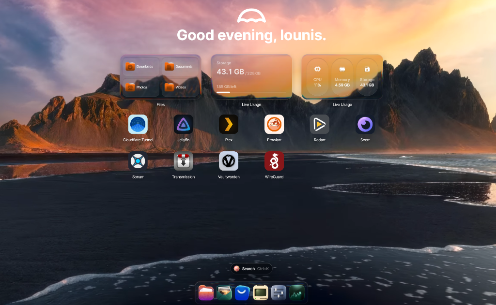
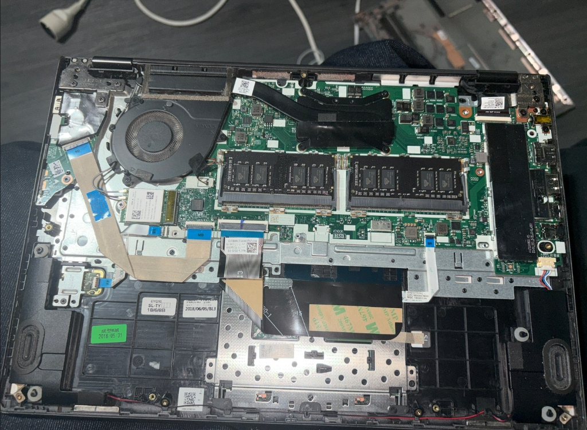
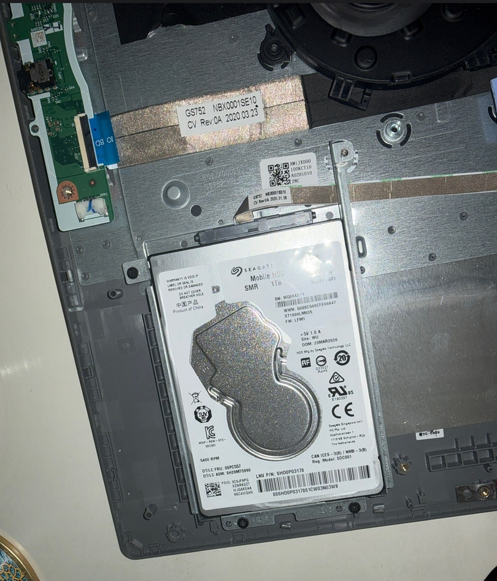

# 🍎 Plezy TV — Port & Réimplémentation Native pour Fire TV & Android TV

<p align="center">
  
</p>

<p align="center">
  
  
  
  
  
  
</p>

---

## 🌟 Présentation & Genèse du Projet

### 🎯 Pourquoi ce projet ?
L'application **Plezy TV** est réputée pour son interface moderne, soignée et épurée, mais elle est **totalement indisponible sur Amazon Fire TV** :
1. **Absence sur l'Amazon Appstore** : Plezy n'est pas distribué pour l'écosystème Fire TV d'Amazon.
2. **Incompatibilité matérielle et logicielle** : Beaucoup de clés Fire TV Stick en circulation tournent encore sous **Fire OS 5 (Android 5.1 / API 22)** avec seulement **1 Go de mémoire vive**, ce qui rend les applications modernes Web/Flutter/React-Native instables ou impossibles à exécuter.

### 💡 La Solution : Recoder Plezy TV pour Fire TV
Ce projet a pour but de **recoder entièrement Plezy TV *from scratch*** en **Kotlin natif**, sur mesure pour l'écosystème Fire TV et Android TV :
* **Compatibilité rétroactive Fire OS 5+ (`minSdk = 22`)** : Fonctionne sur toutes les générations de Fire TV Stick, y compris les plus anciennes.
* **Ergonomie Plezy TV + Style "Liquid Glass" Infuse 8 / Apple TV** : Reproduction fidèle des écrans d'origine (`tv-home`, `tv-library`, `tv-md`, `tv-player`).
* **Intégrations avancées exclusives** : Connexion directe à **Jellyfin** (avec Quick Connect) et pont natif avec **Overseerr / Jellyseerr** pour demander des films et séries en un clic directement depuis son canapé.
* **Optimisation mémoire chirurgicale** : Développé pour maintenir un affichage fluide à 60 FPS sans crash sur les appareils limités à 1 Go de RAM.

---

## ✨ Fonctionnalités Clés

### 🎨 1. Interface "Liquid Glass" (Apple TV & Infuse 8)
* **Design Verre Dépoli (Frosted Glass)** : Arrière-plans sombres translucides, dégradés d'ombrage dynamiques et cartes à coins arrondis élégantes.
* **Hero Banner immersif** : En-tête grand format avec mise à jour instantanée du fond d'écran au survol, métadonnées complètes (Note IMDb/TMDB, classification d'âge, durée, année, genres et synopsis).
* **Navigation fluide au D-Pad** : Effet de focus avec contour lumineux blanc, mise à l'échelle douce et transitions réactives adaptées à la télécommande.
* **Rails personnalisés** :
  * *Reprendre la lecture* (Continue Watching) avec barre de progression de lecture intégrée.
  * *Récemment ajoutés* (Séries & Films séparés).
  * *Catalogue Bibliothèque* avec filtres et grille dynamique.

### 🎬 2. Lecteur Vidéo Haute Précision
* **Timeline par Chapitres** : Scrubber découpé en segments selon les chapitres du média avec titres et marqueurs de position.
* **Calculateur d'heure de fin** : Indication dynamique de l'heure à laquelle le média se terminera (*Ends at 23:45*).
* **Contrôles OSD épurés** : Recul / Avance rapide (-10s / +10s), Play/Pause instantané, sélection des pistes audio et sous-titres directement à la télécommande.
* **Détection Intelligente des Codecs (`CodecDetector`)** :
  * **Direct Play matériel** pour tous les flux `H.264 / AVC ≤ 1080p`.
  * **Transcodage automatique HLS (`master.m3u8`)** côté serveur Jellyfin pour les formats trop lourds (`HEVC/H.265`, `AV1`, `VP9`, `4K`), évitant les crashs matériels sur les anciens sticks TV.

### 🔍 3. Intégration Native Overseerr / Jellyseerr
* **Découverte intégrée** : Parcourez les tendances, les films et séries populaires du moment sans quitter l'interface TV.
* **Demande en 1 Clic** : Envoyez instantanément vos requêtes vers **Overseerr / Jellyseerr**, qui les transmet automatiquement à **Radarr / Sonarr / Transmission**.
* **Statut de disponibilité en direct** : Badges clairs (*Disponible*, *Demandé*, *En cours de traitement*).

### ⚡ 4. Optimisations Matérielles Stick 1 Go RAM
* **Empreinte mémoire divisée par 2** : Configuration de **Glide** en décodage `RGB_565` (16 bits par pixel au lieu de 32 bits).
* **Cache mémoire strict** : Cache mémoire d'images plafonné à 16 Mo, avec libération agressive sur événement système `onTrimMemory`.
* **Tampon ExoPlayer calibré** : Buffer vidéo limité à 12 Mo (15 secondes max) pour garantir qu'aucun débordement de mémoire (*OutOfMemory*) ne survienne lors de la lecture.

### 🧹 5. Suite Débloat CleanYourTV Intégrée
Le projet inclut une suite complète d'optimisation Fire TV basée sur l'architecture de **[CleanYourTV](https://cleanyour.tv/)** :
* **[`cleanyour-tv-debloat.ps1`](cleanyour-tv-debloat.ps1)** :
  * Désactivation de l'ID publicitaire Amazon, du suivi et de la télémétrie.
  * Suppression de l'économiseur d'écran vidéo publicitaire (gain direct de 100 Mo de RAM).
  * Mode "Zero-Lag UI" (échelle d'animations système à 0.0 ms pour une réactivité instantanée).
  * Arrêt et purge de 39 applications bloatware d'arrière-plan (+37% de RAM disponible mesurée).
* **[`restore-firetv.ps1`](restore-firetv.ps1)** : Script de réversibilité à 100% permettant de remettre la Fire TV dans son état constructeur d'origine en une commande.

---

## 📸 Aperçu de l'Interface

| Écran d'Accueil (tv-home) | Détails Média & Saisons (tv-md) |
| :---: | :---: |
|  |  |

| Bibliothèque Complète (tv-library) | Lecteur Vidéo Infuse (tv-player) |
| :---: | :---: |
|  |  |

---

## 🛠️ Structure du Projet

```text
app-firetv/
├── app/
│   ├── build.gradle.kts           # Configuration Android SDK (minSdk 22, targetSdk 28)
│   └── src/main/
│       ├── AndroidManifest.xml    # Déclarations Leanback, activités et permissions TV
│       ├── java/com/plezy/jellyfin/
│       │   ├── PlezyApp.kt        # Initialisation Glide basse mémoire & purge RAM
│       │   ├── data/
│       │   │   ├── api/           # Clients JellyfinClient & SeerrClient (OkHttp / REST)
│       │   │   └── model/         # Modèles de données (Média, Saisons, Épisodes, Requêtes)
│       │   ├── ui/
│       │   │   ├── login/         # Connexion serveur & Quick Connect
│       │   │   ├── main/          # Écran d'accueil, rails horizontaux & bibliothèque
│       │   │   ├── detail/        # Fiche média avec sélection des saisons/épisodes & Overseerr
│       │   │   └── player/        # Lecteur ExoPlayer, scrubber de chapitres & OSD
│       │   └── util/              # CodecDetector, formatters et gestionnaires D-pad
│       └── res/                   # Layouts XML, styles Liquid Glass, drawables & chaînes
├── cleanyour-tv-debloat.ps1       # Script PowerShell d'optimisation Fire TV Stick (CleanYourTV)
├── restore-firetv.ps1             # Script PowerShell de restauration d'origine
├── sideload-firetv.bat            # Script de déploiement ADB automatique en un clic
├── build.gradle.kts               # Configuration racine Gradle
└── settings.gradle.kts            # Définition des modules et dépôts
```

---

## 🏠 Le Serveur DIY : Du PC Portable Recyclé au Home Lab Autonome

En coulisse, **Plezy TV** n'est que la vitrine de salon d'une infrastructure personnelle complète. L'application est alimentée par un **serveur NAS maison conçu à partir d'un ancien PC portable recyclé** associé à du stockage sur disque dur (HDD Seagate 1 To, SSD).

### 🛠️ De Proxmox VE à UmbrelOS
* **L'expérience Proxmox** : Le serveur tournait initialement sous l'hyperviseur **Proxmox VE** (avec machines virtuelles et conteneurs LXC).
* **La migration vers UmbrelOS** : Pour supprimer la surcharge liée à la virtualisation, libérer un maximum de ressources processeur et mémoire, et bénéficier d'un écosystème Docker prêt à l'emploi avec une interface unifiée, le système a été basculé sous **UmbrelOS**.
* **Les services auto-hébergés actifs** :
  * 🎬 **Streaming & Médiathèque** : Jellyfin, Plex
  * ⚡ **Gestion & Automatisation des Téléchargements** : Overseerr / Seerr, Radarr, Sonarr, Prowlarr, Transmission
  * 🔒 **Autonomie & Vie Privée** : Vaultwarden (coffre-fort de mots de passe souverain), WireGuard (VPN chiffré), Cloudflare Tunnel (accès sécurisé distant)

<p align="center">
  
</p>

| Carte mère & Refroidissement PC Portable | Intégration HDD Seagate 1 To |
| :---: | :---: |
|  |  |

### 🚀 Améliorations en cours & Vision
Le serveur continue d'évoluer :
* Achat et ajout régulier de nouveaux composants matériels (extension de RAM, stockage étendu, amélioration thermique).
* **Le but ultime** : **Devenir 100% autonome et souverain sur la quasi-totalité de ses services numériques du quotidien** (streaming vidéo, synchronisation de photos/documents, gestion de mots de passe, accès réseau sécurisé), sans dépendre des abonnements et plateformes cloud tierces.

---

## 🚀 Installation & Déploiement

### Option A : Déploiement rapide via ADB (Sideload)
Si votre Fire TV Stick est connectée au même réseau local Wi-Fi et que le débogage ADB est activé :

1. Connectez-vous à la Fire TV :
   ```bash
   adb connect <IP_DE_VOTRE_FIRE_TV>:5555
   ```
2. Installez l'APK précompilé :
   ```bash
   adb install -r PlezyTV-FireOS-API22.apk
   ```
*(Ou lancez simplement le fichier [`sideload-firetv.bat`](sideload-firetv.bat)).*

### Option B : Compilation depuis les sources (Android Studio)
1. Clonez ce dépôt :
   ```bash
   git clone https://github.com/votre-compte/plezy-tv.git
   ```
2. Ouvrez le projet dans **Android Studio** (Koala / Ladybug ou supérieur).
3. Laissez Gradle synchroniser les dépendances.
4. Lancez la compilation :
   ```bash
   ./gradlew assembleDebug
   ```
5. L'APK généré se trouvera dans `app/build/outputs/apk/debug/app-debug.apk`.

---

## ⚙️ Configuration Initiale

1. **Serveur Jellyfin** :
   * Au premier démarrage de l'application, saisissez l'adresse de votre serveur (ex: `http://jellyfin.local:8096`, `http://<SERVER_IP>:8096` ou votre nom de domaine).
   * Connectez-vous avec vos identifiants ou utilisez **Quick Connect**.
2. **Jellyseerr / Overseerr** :
   * Dans l'interface, accédez à la section Seerr pour associer votre instance (`http://<SEERR_IP>:5055` ou nom de domaine).
   * Vos demandes de médias seront instantanément répercutées dans vos services de téléchargement automatisés (Radarr/Sonarr).

---

## 📄 Licence

Ce projet est sous licence **MIT**. Vous êtes libre de l'utiliser, le modifier et le distribuer selon vos besoins.
